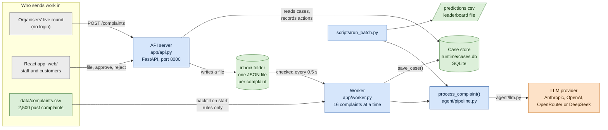
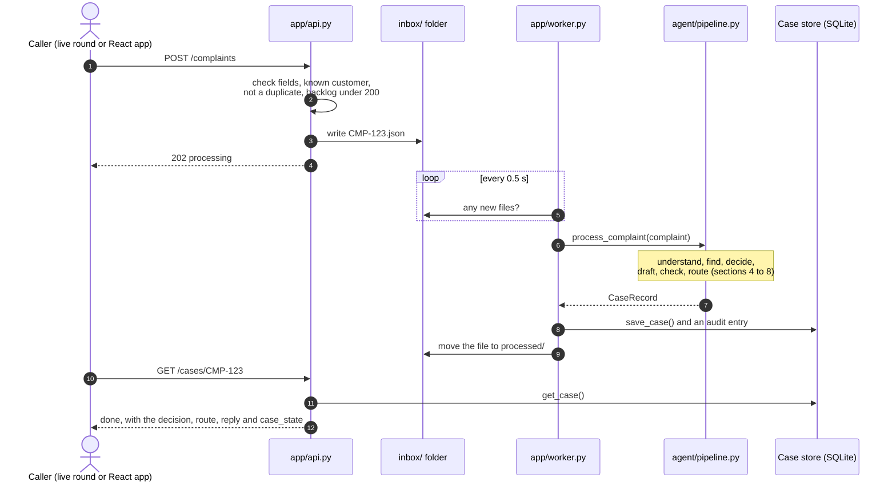
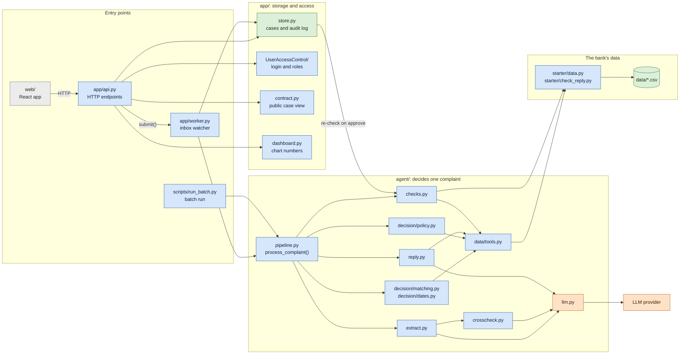
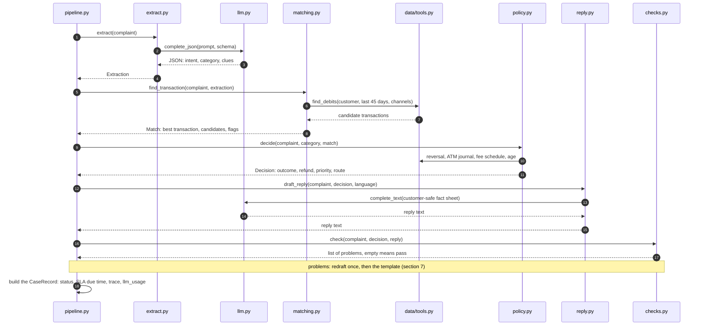
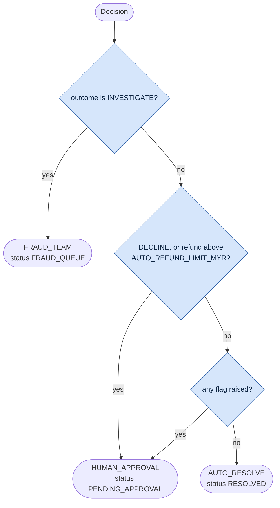
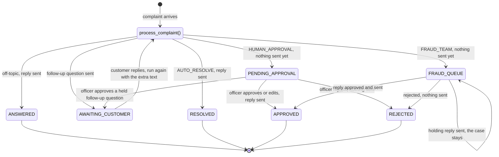
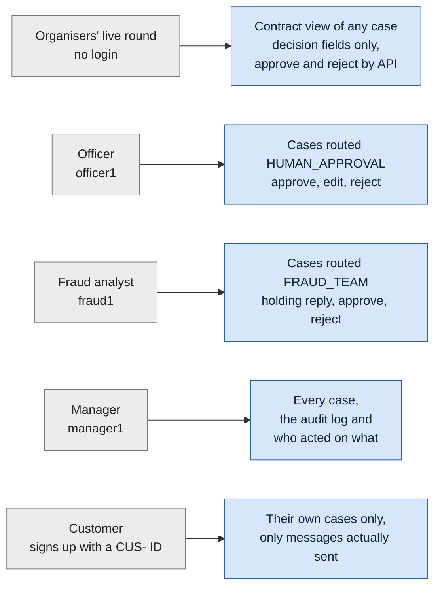

# How a complaint flows through the agent

Every complaint goes through one function, [`process_complaint()`](agent/pipeline.py). The live app, the inbox worker
and the batch run all call it. There is no agent framework (no LangGraph or LangChain): the flow is plain Python, and
all LLM traffic goes through [`agent/llm.py`](agent/llm.py) using the `anthropic` or `openai` SDK.

**The LLM reads and writes; code decides.** The LLM classifies the message, pulls out the clues and drafts the reply.
Code finds the transaction, decides the refund, checks the reply and picks the queue. The LLM never chooses the
outcome, the amount or the route.

In the diagrams, orange boxes are LLM calls, blue boxes are plain code, green boxes are where data is stored and grey
boxes are people or programs outside the agent.

**In 30 seconds:** a complaint comes in over HTTP and waits as a file in `inbox/`. A worker runs it through five
steps (understand, find, decide, draft and check, route) and saves the result in a database. Anything risky waits there
until a person approves it.

Contents:

- **How the code is put together:** 1. the running system, 2. the life of one complaint, 3. the code map, 4. the order
  of calls inside the agent
- **How one complaint is decided:** 5. the whole pipeline, 6. UNDERSTAND, 7. DRAFT and CHECK, 8. ROUTE, 9. LLM calls
- **What happens after the decision:** 10. a case's life in the queues, 11. who sees what

## 1. The running system

`run.bat` (or `run.sh`) starts three programs: the React app, the API server and the worker. The API never runs the
agent itself. It saves each complaint as a file in `inbox/` and answers at once. The worker picks the files up and
runs the agent on them. Everything ends up in one SQLite database.

Why a folder sits between the API and the agent:

- The API answers in milliseconds, although the agent takes about 5 seconds per complaint with the LLM.
- The worker handles 16 complaints at once. Past 200 waiting, the API answers `503 busy` instead of accepting work it
  can't finish in time.
- A complaint that crashes the agent moves to `inbox/failed/` with the error next to it. Nothing is lost silently.
- There is one way in: the live round, the React form and a customer's follow-up reply all arrive as inbox files.

The batch script skips the API and the inbox. It calls `process_complaint()` directly on many complaints and writes
`predictions.csv` for the leaderboard.

## 2. The life of one complaint

Until the worker saves the case (step 8), `GET /cases/CMP-123` answers `processing`. The same `complaint_id` posted twice never makes a second
case: the API returns the existing one.

## 3. The code map: which file calls which

An arrow means "calls". The agent (`agent/`) only decides one complaint. It knows nothing about HTTP, files or logins:
that is the job of `app/`.

Only `llm.py` talks to an LLM, and only `data/tools.py` reads the bank's data. Everything else asks those two.

| File | Its job in one line |
| --- | --- |
| [`app/api.py`](app/api.py) | HTTP endpoints: takes complaints in, serves cases, records approve and reject |
| [`app/worker.py`](app/worker.py) | Watches `inbox/`, runs the agent on each file, backfills `data/complaints.csv` on start |
| [`app/store.py`](app/store.py) | The SQLite database: the cases table, the audit log, approve, reject and holding reply |
| [`app/contract.py`](app/contract.py) | The organisers' view of a case: decision fields only, no personal data |
| [`app/UserAccessControl/`](app/UserAccessControl/) | Login, tokens and the four roles |
| [`app/dashboard.py`](app/dashboard.py) | The numbers behind the staff dashboard charts |
| [`agent/pipeline.py`](agent/pipeline.py) | `process_complaint()`: runs the steps in order and builds the case record |
| [`agent/extract.py`](agent/extract.py) | UNDERSTAND: reads the message with the LLM, or with keyword rules |
| [`agent/crosscheck.py`](agent/crosscheck.py) | A second look when the LLM and the keyword rules disagree on the category |
| [`agent/decision/matching.py`](agent/decision/matching.py) | FIND: scores the customer's transactions against the clues |
| [`agent/decision/dates.py`](agent/decision/dates.py) | Turns "last Tuesday" into a date range |
| [`agent/decision/policy.py`](agent/decision/policy.py) | DECIDE and ROUTE: refund rules, priority and queue |
| [`agent/reply.py`](agent/reply.py) | DRAFT: an LLM reply, or a fixed template |
| [`agent/checks.py`](agent/checks.py) | CHECK: tests the reply against the data |
| [`agent/llm.py`](agent/llm.py) | The only file that calls an LLM: providers, budgets, errors |
| [`agent/data/tools.py`](agent/data/tools.py) | Every lookup into the bank's data: transactions, reversals, fees, ATM journal |
| [`agent/schemas.py`](agent/schemas.py) | The shapes of the data passed between the steps |
| [`agent/summary.py`](agent/summary.py) | The at-a-glance summary staff see on a case |
| [`starter/data.py`](starter/data.py) | Loads the CSVs in `data/` into memory, once per process |
| [`scripts/run_batch.py`](scripts/run_batch.py) | Runs the pipeline over many complaints and writes `predictions.csv` |
| [`web/`](web/) | The React app: staff queues, dashboard and customer portal |

`agent/policy.py`, `agent/matching.py`, `agent/dates.py` and `agent/tools.py` are one-line aliases left behind when
those files moved into `agent/decision/` and `agent/data/`.

## 4. Inside the agent: the order of calls

This is one complaint on the complaint path, with what each function hands back. Off-topic messages and follow-up
questions skip matching and policy (section 5).

The data handed from step to step ([`agent/schemas.py`](agent/schemas.py)):

| Object | Made by | What it holds |
| --- | --- | --- |
| complaint (a dict) | the API or the CSV | `complaint_id`, `customer_id`, `received_at`, `channel`, `subject`, `text`, and `follow_ups` |
| `Extraction` | `extract.py` | intent, category, language and the clues: amount, date phrase, counterparty, card last 4, fee type and month |
| `Match` | `matching.py` | the best transaction (or none), the top 5 candidates with scores, flags such as `NO_MATCH`, how the date was read |
| `Decision` | `policy.py` | `matched_txn_id`, outcome, refund, priority, route, reasons, flags and the evidence used |
| `CaseRecord` | `pipeline.py` | all of the above, plus the reply, its language, the status, the SLA due time, the step timings and LLM usage |

The worker saves the `CaseRecord` as one row of the `cases` table. The main fields get their own columns for the queues,
and the whole record is kept as JSON in the `record` column.

## 5. Inside `process_complaint()`: the whole pipeline

The extract step and the draft step both have a code fallback. With `LLM_PROVIDER` unset, or when a call fails,
keyword rules and fixed templates do the work, so a complaint is never lost to an LLM error.

## 6. UNDERSTAND: how `extract.py` uses the LLM

The three intents:

| Intent | Meaning | What happens next |
| --- | --- | --- |
| `COMPLAINT` | A specific problem, even with some details missing. Anything that could be fraud is always a complaint. | Find the transaction, apply policy, reply |
| `NEEDS_DETAILS` | Too general to act on ("my account has a problem") | Ask the customer for `missing_info`, at most 2 rounds |
| `OUT_OF_SCOPE` | Not a banking complaint (chit-chat, product questions, advice) | Polite answer, no case action |

Only the LLM can return `NEEDS_DETAILS` or `OUT_OF_SCOPE`. Two cases go down the complaint path anyway: a
`NEEDS_DETAILS` message in a fraud category (possible fraud never waits for a follow-up), and one whose 2 follow-ups
are used up. Both get a flag, so a person reviews them.

## 7. DRAFT and CHECK: the reply loop

The check is code on purpose: you can't use the model to check the model. The drafter never sees internal reasons
or personal data such as the customer's age, so it cannot repeat them.

## 8. ROUTE: which queue a case lands in

[`policy.route()`](agent/decision/policy.py) is a few lines of code, checked in this order:

Flags come from matching (`NO_MATCH`, ...), the crosscheck (`CROSSCHECK_UNRESOLVED`), vague reports
(`VAGUE_FRAUD_REPORT`, `DETAILS_STILL_MISSING`) and the reply loop (`DRAFT_REJECTED`, `CHECK_FAILED`). Any flag stops
a case going out on its own.

Two cases skip `route()` entirely: `OUT_OF_SCOPE` messages end as `ANSWERED`, and follow-up questions end as
`AWAITING_CUSTOMER`, with no outcome or route yet.

## 9. LLM calls per complaint

| Call | Where | When |
| --- | --- | --- |
| Extraction | `extract.extract_llm()` | Every complaint |
| Second look | `crosscheck.check()` | Only when the LLM and keyword rules disagree on the category |
| Reply draft | `reply.draft_*()` | Every complaint |
| Redraft | `reply.draft_*()` with feedback | Only when the first draft fails the check |

That's 2 calls normally and 4 at most. [`llm.Usage`](agent/llm.py) caps each complaint at
`LLM_MAX_CALLS_PER_COMPLAINT` (default 6) and `LLM_MAX_TOKENS_PER_COMPLAINT` (default 40,000). Calls, tokens and any
failure kinds are saved in the case record (`llm_usage`), and each step's timing is saved in `trace`.

## 10. After the pipeline: a case's life in the queues

The pipeline gives each case a status. From there, people move it on through [`app/store.py`](app/store.py):

- **Nothing in `PENDING_APPROVAL` or `FRAUD_QUEUE` reaches the customer until a person acts.**
- Every reply a person sends, edited or not, goes through the same `checks.check()` as the agent's drafts. If it fails,
  nothing is sent, the API answers 422 with the problems, and the attempt is logged as `approval_blocked`.
- Approving or rejecting never changes the agent's decision. What the person did is stored next to it as `human_action`.
- A customer's reply is appended to the original message, and the whole case runs through the pipeline again. After 2
  follow-ups the case goes to an officer instead of asking again.
- Every step, by the agent or a person, adds a row to the `audit` table: who, what, when. The manager reads it at
  `GET /audit`. Staff can also flag a case that has already been sent for review; that only adds an audit row.

## 11. Who sees what

[`roles.py`](app/UserAccessControl/roles.py) holds the rules in one place, and every endpoint applies them.

A customer never sees a draft waiting for approval, the internal reasons or the evidence. They only see their own
message and the replies that actually went out.
