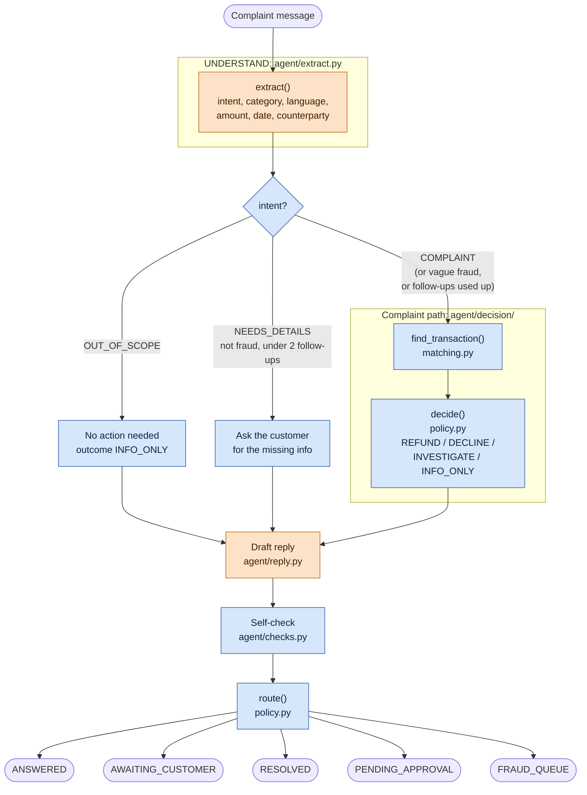
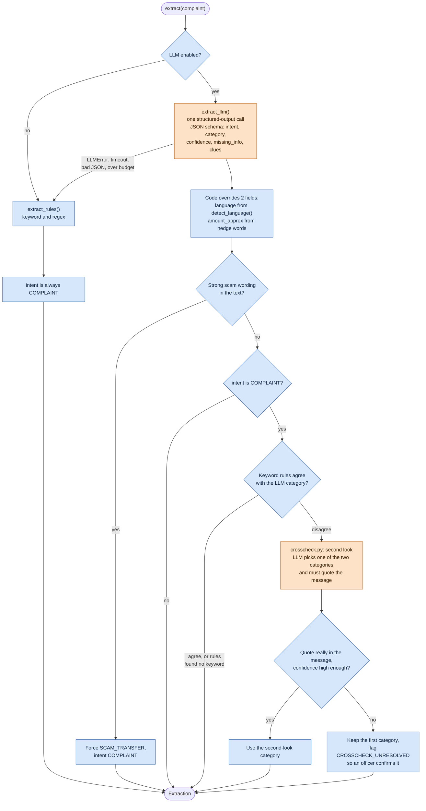
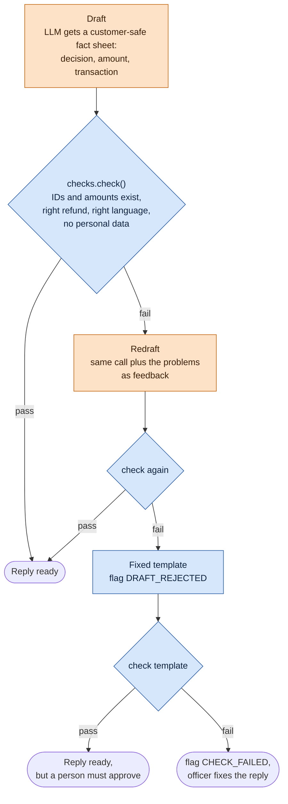

# How a complaint flows through the agent

Every complaint goes through one function, [`process_complaint()`](agent/pipeline.py). The live app, the inbox worker
and the batch run all call it. There is no agent framework (no LangGraph or LangChain): the flow is plain Python, and
all LLM traffic goes through [`agent/llm.py`](agent/llm.py) using the `anthropic` or `openai` SDK.

**The LLM reads and writes; code decides.** The LLM classifies the message, pulls out the clues and drafts the reply.
Code finds the transaction, decides the refund, checks the reply and picks the queue. The LLM never chooses the
outcome, the amount or the route.

In the diagrams, orange boxes are LLM calls and blue boxes are plain code.

## 1. The whole pipeline

The extract step and the draft step both have a code fallback. With `LLM_PROVIDER` unset, or when a call fails,
keyword rules and fixed templates do the work, so a complaint is never lost to an LLM error.

## 2. UNDERSTAND: how `extract.py` uses the LLM

The three intents:

| Intent | Meaning | What happens next |
| --- | --- | --- |
| `COMPLAINT` | A specific problem, even with some details missing. Anything that could be fraud is always a complaint. | Find the transaction, apply policy, reply |
| `NEEDS_DETAILS` | Too general to act on ("my account has a problem") | Ask the customer for `missing_info`, at most 2 rounds |
| `OUT_OF_SCOPE` | Not a banking complaint (chit-chat, product questions, advice) | Polite answer, no case action |

Only the LLM can return `NEEDS_DETAILS` or `OUT_OF_SCOPE`. Two cases go down the complaint path anyway: a
`NEEDS_DETAILS` message in a fraud category (possible fraud never waits for a follow-up), and one whose 2 follow-ups
are used up. Both get a flag, so a person reviews them.

## 3. DRAFT and CHECK: the reply loop

The check is code on purpose: you can't use the model to check the model. The drafter never sees internal reasons
or personal data such as the customer's age, so it cannot repeat them.

## 4. ROUTE: which queue a case lands in

[`policy.route()`](agent/decision/policy.py) is a few lines of code, checked in this order:

Flags come from matching (`NO_MATCH`, ...), the crosscheck (`CROSSCHECK_UNRESOLVED`), vague reports
(`VAGUE_FRAUD_REPORT`, `DETAILS_STILL_MISSING`) and the reply loop (`DRAFT_REJECTED`, `CHECK_FAILED`). Any flag stops
a case going out on its own.

Two cases skip `route()` entirely: `OUT_OF_SCOPE` messages end as `ANSWERED`, and follow-up questions end as
`AWAITING_CUSTOMER`, with no outcome or route yet.

## LLM calls per complaint

| Call | Where | When |
| --- | --- | --- |
| Extraction | `extract.extract_llm()` | Every complaint |
| Second look | `crosscheck.check()` | Only when the LLM and keyword rules disagree on the category |
| Reply draft | `reply.draft_*()` | Every complaint |
| Redraft | `reply.draft_*()` with feedback | Only when the first draft fails the check |

That's 2 calls normally and 4 at most. [`llm.Usage`](agent/llm.py) caps each complaint at
`LLM_MAX_CALLS_PER_COMPLAINT` (default 6) and `LLM_MAX_TOKENS_PER_COMPLAINT` (default 40,000). Calls, tokens and any
failure kinds are saved in the case record (`llm_usage`), and each step's timing is saved in `trace`.
